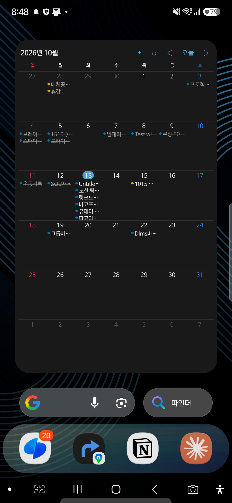
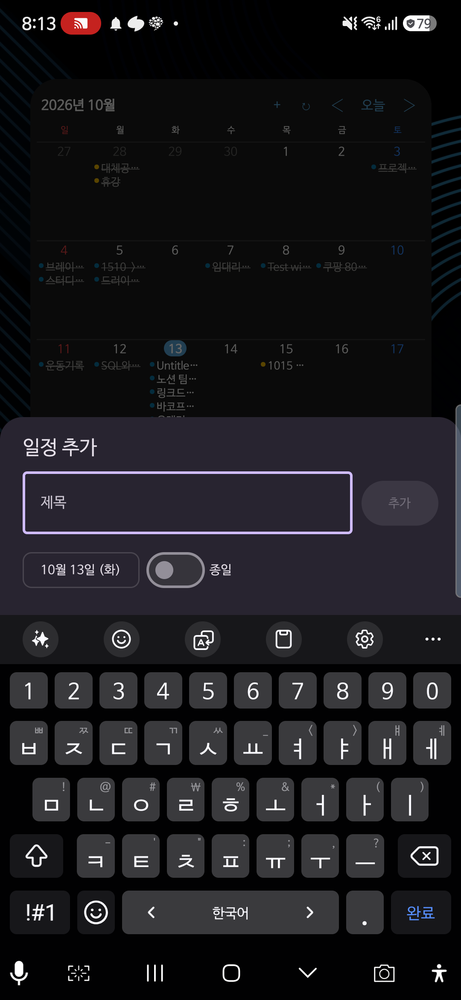
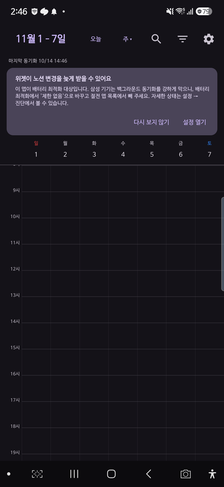
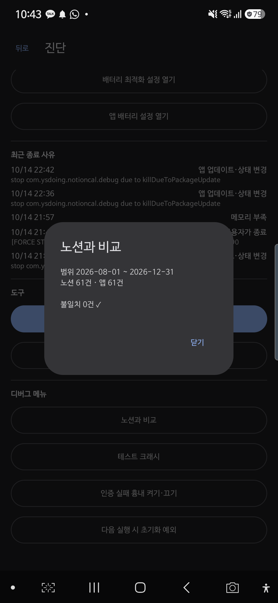

# 노션 월간 — 노션 DB를 위한 Android 월간 달력·위젯

노션 데이터베이스의 일정을 **Galaxy S25 홈 화면에서 한 달 단위로 보고, 위젯에서 바로 추가·완료**하는 개인용 Android 앱입니다. 노션 원본 DB와 양방향으로 맞춥니다.

공식 노션 캘린더 Android 앱에서 직접 느낀 불편과 Play 스토어 리뷰에서 모은 불편을 문제로 정의했습니다. 그다음 **"언제 열어도 바로 뜨고, 노션과 어긋나지 않는 달력"**을 목표로 이틀(2026-10-13~14) 동안 Phase 0~5와 P2 일부를 만들었습니다.

| 홈 화면 월간 위젯 | 위젯에서 바로 추가 | 주 보기 | 노션과 대조(불일치 0) |
| --- | --- | --- | --- |
|  |  |  |  |

---

## 1. 문제: 노션 일정을 폰에서 믿고 볼 수 없었다

### 내가 겪은 불편

노션 📅 Calendar DB에 일정·학습·습관을 모두 기록합니다. 그런데 폰에서는 이렇게 쓸 수 없었습니다.

- **홈 화면에서 한 달을 한눈에 보기**: 앱을 열지 않고 이번 달 노션 일정을 DB·카테고리 색으로 보고 싶었습니다. 공식 앱은 최대 3일 보기라 월 단위로 볼 수 없었습니다.
- **위젯에서 바로 추가·완료**: 날짜를 눌러 일정을 넣고, 체크하면 노션의 '완료' 체크박스가 바뀌어야 했습니다.
- **맥북에서 고친 내용이 폰에 반영되기**: 맥북 노션에서 고친 내용이 폰에 뜨고, 앱을 열면 바로 최신이 되어야 했습니다.
- **오프라인에서도 열리기**: 지하철에서도 마지막 데이터로 바로 열리고, 입력은 저장해 두었다가 연결되면 보내야 했습니다.

### Play 스토어 리뷰에서 찾은 불편

노션 캘린더 Android는 평점 3.8(리뷰 약 1.74만 건)입니다. 평점 분포는 1~2점 37%, 4~5점 59%로 양극화돼 있습니다. Google Play 10개 언어 페이지와 AppBrain에서 리뷰 35건을 모아 유형별로 나눴습니다(2026-10-12 수집).

| 불편 | 리뷰 근거 |
| --- | --- |
| **실행 불가·크래시**: 로고·검은 화면에서 멈춤, 업데이트 후 안 열림, **Galaxy S25에서 실행 안 됨** | 35건 중 15건, 그중 12건이 2026년 6~9월 작성 |
| **로그인 풀림·로그인 루프**: 하루 2번 재로그인, 그동안 위젯이 빈 화면 | 2026년 6~8월 |
| **월·주 보기 없음**: 최대 3일 보기 | 2024-08~2026-09 꾸준히 |
| **노션 연동 한계**: 위젯에 노션 항목 없음, 항목명 대신 DB명 표시, 속성 보기·편집 불가, 반복 불가 | 2024-10~2026-09 |
| **동기화 실패·일정 소실**: 만든 직후 삭제, 지운 일정이 남음 | 2024~2026 |
| **입력 오류**: 시간 입력 버그, 날짜·반복 요일이 하루 밀림 | 2024~2026 |
| **화면 배율·색**: 확대 불가로 정보가 적게 보임, 색 선택지 부족 | 2025-03~2026-08 |
| **알림**: 최대 1시간 전, 노션 항목 알림 없음 | 2025~2026 |
| **오프라인**: 보기만 되고 편집·동기화는 안 됨 | 2026-09 |

> 리뷰는 노출 순서상 무작위 표본이 아니므로 비율은 우선순위 참고용으로만 썼습니다. 전체 목록과 출처는 [`docs/PRD.md` §2](docs/PRD.md)에 있습니다.

## 2. 문제 정의

리뷰 상위 3개(실행 불가, 로그인, 월·주 보기) 가운데 앞의 둘은 기능이 모자란 문제가 아니었습니다. **"앱을 믿고 열 수 있는가"**의 문제였습니다. 그래서 기능보다 구조를 먼저 정했습니다.

| 원인 | 정의한 원칙 |
| --- | --- |
| 네트워크·로그인 상태가 화면 표시를 막는다 | **화면과 위젯은 로컬 DB(Room)만 읽는다.** 노션 통신은 동기화 모듈만 한다. |
| 쓰기가 실패하면 일정이 사라지거나 중복된다 | **노션 쓰기는 모두 아웃박스 큐를 거친다.** 폰에 먼저 반영하고 순서대로 보낸다. |
| 로그인 세션이 만료된다 | 만료 없는 **노션 내부 연결 토큰** 하나만 쓴다. 인증 오류여도 캐시는 그대로 보여 준다. |
| 기기·OS 변화에서 깨진다 | 매 단계 **S25 실기기 설치·스크린샷 확인**을 통과 조건으로 둔다. |

**합격선**: S25에서 1초 안에 월 화면이 뜨고, 위젯 조작이 노션에 반영되며, 크래시가 0건입니다.

**하지 않기로 한 것**: 서버·푸시, 노션 본문 편집, iOS, Play 스토어 배포. 개인 설치(APK)를 전제로 하고, 서버 없이 폰이 노션 API를 직접 부릅니다.

## 3. 해결: 무엇을 만들었나

| 리뷰·불편 | 이 앱의 해결 | 요구사항 ID |
| --- | --- | --- |
| 실행 불가·크래시 | 로컬 캐시로 바로 실행, 콜드 스타트 **232ms**(목표 1초). DB 마이그레이션 테스트·DB 손상 자동 복구, 초기화 실패 시 안전 모드, Sentry 크래시 수집 | PF-01·02·04·09·10 |
| 로그인 풀림 | 내부 연결 토큰을 Tink + Android Keystore로 암호화해 저장. 401이어도 화면·위젯은 유지하고 배너와 위젯 오류 점만 표시 | NS-01, PF-05, SEC-01 |
| 월·주 보기 없음 | 월 그리드 + 주·3일·목록 보기, 두 손가락 확대, 검색, DB·카테고리 필터 | MV-01~10 |
| 위젯에 노션 항목 없음 | Glance 월간 위젯(2×2부터 크기별 레이아웃, 기본 4×4)과 '오늘부터 7일' 목록 위젯. 위젯에서 추가·완료·월 이동 | WG-01~08, WI-01~07 |
| 항목명·속성 | 페이지 제목 표시, 노션 select·status 색, 추가 속성(select·multi_select·number·url) 보기·편집 | EX-03, EX-07 |
| 반복 불가 | 반복 규칙(매일·매주 여러 요일·매월·매년, 횟수·종료일)으로 페이지를 한꺼번에 만든다. 만들기 전 개수·날짜 확인 | NS-10 |
| 동기화 실패·일정 소실 | 아웃박스 큐, 증분 + 범위 대조 동기화, 속성 단위 충돌 처리, 생성 중복 방지 | NS-03~06 |
| 입력 오류·하루 밀림 | 퀵 입력 시트와 자연어 입력('내일 3시 회의', '10/30~11/2 제주'), 날짜는 서울 기준으로 테스트로 고정 | WI-01·07, NS-07 |
| 배율·색 | 앱·위젯 배율 조절, 글꼴 크기 대응, Material You, DB·옵션별 색 | WS-01~05, S25-10 |
| 알림 | 시간 일정 N분 전(여러 개)·종일 일정 시각 알림, 알림에서 바로 '완료' | EX-01, S25-11 |
| 오프라인 | 오프라인 편집을 아웃박스에 저장했다가 연결되면 전송 | PF-02, NS-04 |
| (S25 특화) | 삼성 절전 안내, 동기화 진단 화면, 종료 사유 기록, 공휴일 표시, 빠른 설정 타일·앱 아이콘 '빠른 추가' | S25-03·04·09, EX-02·06 |

## 4. 설계와 기술

### 아키텍처

```
 ┌────────── 화면(Compose) ──────────┐   ┌──── 위젯(Glance) ────┐
 │ :feature:month  :feature:quicksheet│   │ :widget              │
 │ :feature:diagnostics               │   │ (노션 모듈 의존 금지) │
 └───────────────┬────────────────────┘   └──────────┬───────────┘
                 │ 읽기: Flow                         │ 읽기만
                 ▼                                    ▼
          ┌──────────────── :core:data (Room · DataStore) ────────────────┐
          │ events · data_sources · outbox · conflicts · sync_log · ...  │
          └───────▲───────────────────────────────▲───────────────────────┘
                  │ upsert · 삭제 반영              │ 쓰기 = Room 즉시 반영 + 아웃박스 행
          ┌───────┴──────── :core:sync (WorkManager) ┴──────┐
          │ NotionSyncEngine · OutboxProcessor · Comparer   │
          └───────────────────────┬─────────────────────────┘
                                  ▼
                    :core:notion (Retrofit · OkHttp · 매핑)  ──▶  Notion API 2026-03-11
```

- **모듈 경계로 규칙을 강제합니다.** `:widget`은 `:core:notion`에 의존하지 않습니다. 그래서 위젯이 네트워크를 부르는 코드는 **빌드 단계에서** 막힙니다.
- **쓰기 흐름**: 화면은 Room에 즉시 반영하고 아웃박스에 작업을 쌓습니다. 화면·위젯은 바로 바뀌고, 노션 전송은 뒤따릅니다. 성공하면 서버 응답으로 덮어씁니다. 400 검증 오류면 되돌리고 알립니다.
- **위젯 갱신**: 데이터가 바뀐 지점마다 갱신을 요청합니다(300ms 묶음). 측정한 반영 시간은 307~435ms입니다.

### 기술 스택

| 영역 | 선택 |
| --- | --- |
| 언어·UI | Kotlin, Jetpack Compose (Material 3) |
| 위젯 | Jetpack Glance 1.2 (SizeMode.Exact, 생성 미리보기) |
| 로컬 DB | Room 2.8 (스키마 v7, AutoMigration 1→7) + Flow |
| 백그라운드 | WorkManager(주기 동기화·아웃박스), AlarmManager(알림·자정) |
| 네트워크 | Retrofit + OkHttp + kotlinx.serialization |
| DI·설정 | Hilt, DataStore |
| 보안 | Tink AEAD + Android Keystore (토큰 암호화) |
| 품질 | Robolectric·Roborazzi·MockWebServer·Turbine, Macrobenchmark·JankStats·Baseline Profile, StrictMode, Sentry |
| 빌드 | AGP 9, Gradle convention plugin(`build-logic/`), 버전 카탈로그(알파·베타 금지) |

### 노션 동기화 알고리즘 (서버 없이)

1. **범위 조회**: 이번 달 ±2개월 범위를 받되, 시작을 31일 앞당겨 조회합니다. 기간 일정이 걸치는지는 로컬에서 판정합니다. 종료일이 있는 날짜에 노션 날짜 필터가 어떻게 동작하는지는 문서에 없기 때문입니다.
2. **증분 조회**: `last_edited_time`이 '마지막 동기화 − 2분' 이후인 페이지만 받습니다. 노션은 이 값을 분 단위로 내림하므로 겹쳐서 받고, page_id로 중복을 없앱니다.
3. **삭제 감지**: 증분 조회로는 삭제를 알 수 없습니다. 그래서 앱을 열 때는 이번 달, 하루 1회는 전체 범위를 ID로 대조합니다. 빠진 항목은 단건 재조회로 확인한 뒤에만 지웁니다.
4. **충돌**: 보내기 직전에 페이지를 다시 읽어 **속성 단위로** 비교합니다. 양쪽에서 같은 속성을 바꿨으면 노션 값을 남기고 충돌 기록을 남깁니다. 다른 속성이면 둘 다 반영합니다.
5. **속도 제한·재시도**: 분당 180회 토큰 버킷을 씁니다. 429·529 응답은 Retry-After를 따르고, 지수 백오프 + 지터로 최대 6회 재시도합니다.
6. **생성 중복 방지**: 생성이 시간 초과로 끝나면, 다시 보내기 전에 같은 제목·날짜로 방금 생긴 페이지가 있는지 확인합니다.
7. **속성 ID로 매핑**: 속성 이름 대신 ID로 저장합니다. 그래서 노션에서 이름을 바꿔도 연결이 끊기지 않습니다. 속성이 지워지면 앱은 죽지 않고 경고만 띄웁니다.

### 측정 결과 (Galaxy S25, 실제 노션 DB)

| 지표 | 목표 | 결과 |
| --- | --- | --- |
| 콜드 스타트 → 이번 달 일정 표시 | 1.0초 이하 | **232ms** (Baseline Profile 적용 전 318ms) |
| 월 스와이프 느린 프레임 (120Hz) | 5% 미만 | JankStats **0%**, 한 프레임 이상 밀림 1.6% |
| 위젯 조작 → 위젯 반영 | 0.5초 | 307~435ms |
| 월 전환 조회 (4,000건) | 100ms | 중앙값 20.9ms |
| 노션 대조 불일치 | 0건 | **0건** (61건 비교) |
| StrictMode 위반 · 크래시 | 0 | 0 |

자세한 측정 방법과 값은 [`docs/metrics.md`](docs/metrics.md)에 있습니다.

## 5. 과정: 어떻게 만들었나

### PRD → 불변 규칙 → 단계별 게이트

1. **PRD 작성** ([`docs/PRD.md`](docs/PRD.md)): 리뷰 조사, 목표·비목표, 요구사항 ID(MV·WG·NS·PF·S25·EX…), 노션 API 명세, 단계 계획, 완료 기준을 한 문서에 담았습니다.
2. **불변 규칙** ([`CLAUDE.md`](CLAUDE.md)): 매 작업마다 지킬 규칙(Room만 읽기, 아웃박스, 토큰 비노출, 메인 스레드 금지 등)을 짧게 고정했습니다.
3. **AI 페어 프로그래밍**: 저는 Kotlin·Android 경험이 없습니다(주력은 Python). 그래서 Claude Code와 함께 Phase마다 다음 순서를 반복했습니다.
   - **계획**: plan 모드에서 계획을 세우고 승인합니다.
   - **구현**: 테스트를 함께 씁니다.
   - **게이트**: `gradlew test lint` 통과 → S25 실기기 설치 → adb 스크린샷으로 화면 확인.
   - **커밋**: 요구사항 ID를 커밋 메시지에 남깁니다.
   - 확인하지 못한 항목은 "됐다"고 하지 않고 **'미검증'으로 보고**하는 것을 규칙으로 삼았습니다.

| 단계 | 내용 |
| --- | --- |
| Phase 0 | 멀티 모듈 골격, StrictMode, 크래시 수집 비교, 엣지 투 엣지 |
| Phase 1 | **읽기 전용 앱**: 토큰·DB 등록, 동기화 엔진, 월 화면, 오프라인 |
| Phase 2 | **월간 위젯**: 크기별 레이아웃, 월 이동, 날짜 탭, 자정 넘김 |
| Phase 3 | **쓰기**: 아웃박스, 퀵 추가·편집·완료·삭제, 충돌 처리 |
| Phase 4 | **안정성·성능**: 인증 실패·초기화 실패·DB 손상 복구, 진단 화면, Macrobenchmark·Baseline Profile |
| Phase 5 | **P1 기능**: 주·3일·목록 보기, 검색·필터, 추가 속성, 목록 위젯, Material You, 공휴일, 알림 |
| P2 | 빠른 설정 타일·앱 단축키, 반복 일정, 위젯 선택 미리보기 |
| 보완 | 실사용 기록으로 버그 수정, '노션과 비교' 도구, 앱 아이콘 |

읽기(Phase 1)를 먼저 고정한 뒤 쓰기(Phase 3)를 붙였습니다. 그래서 쓰기 단계의 충돌·중복 문제를 따로 떼어 검증할 수 있었습니다.

### 실기기에서 부딪힌 문제와 해결

테스트만으로는 보이지 않던 문제는 대부분 **실기기 게이트와 실사용 기록**에서 드러났습니다.

| 문제 | 원인 | 해결 |
| --- | --- | --- |
| 노션에서 `@섹션 2: 인사부`인 제목이 앱에서 `Untitled DS6PJS`로 보임 | 제목 안의 언급(@)이 가리키는 페이지가 연결에 공유되지 않으면 API가 'Untitled'를 준다 | 공유 안 된 언급은 '@공유 안 된 페이지'로 표시하고, 언급이 든 제목을 편집하면 경고. 근본 해결은 해당 DB를 연결에 공유 |
| '노션과 비교'를 처음 돌리자 8월 일정 1건 불일치 | 앱 업데이트로 해석 방식이 바뀌어도 노션 수정 시각은 그대로라, 이번 달 밖 캐시는 하루 1회 대조까지 옛 값 | 앱이 업데이트되면 다음 동기화에서 전체 범위를 다시 받기 → **불일치 0** |
| 메모리 부족 종료 뒤 'DB 추가' 화면에서 StrictMode 위반 | 화면 주입 과정에서 OkHttp·SSL을 메인 스레드에서 초기화 | `dagger.Lazy`로 첫 호출 때(IO 스레드) 생성 |
| 기기 글꼴을 키우면 위젯 줄이 잘림 | 위젯이 글꼴 변경을 모르고 이전 배율로 줄 높이를 계산 | 설정 변경 감지·실측 줄 높이(1.65배)·글꼴 1.3배 상한, 글꼴 3 × 화면 확대 3 = 9개 조합 확인 |
| 목록 보기가 스크롤 중 맨 앞으로 튐 | 범위를 늘릴 때 목록을 새로 만들며 기준 위치를 잃음 | 기준 날짜 유지, 사용자가 끌 때만 범위 확장 |
| 권한 창을 열 때마다 StrictMode 위반 6건 | 앱 코드가 아닌 One UI 시스템(ASKS) 내부 디스크 접근 | 스택에 앱 프레임이 없음을 확인한 뒤에만 OEM 예외로 분류 |
| Android 12에서 알림이 안 옴 | 알림 권한은 Android 13부터 있는데, 그 전 기기에서도 권한을 검사함 | 버전에 따라 검사하고, 시스템에서 앱 알림이 꺼졌으면 설정 화면 안내 |
| 노션 API 날짜 필터의 기간 처리가 문서에 없음, 수정 시각은 분 단위로 내림 | 플랫폼 제약 | 범위를 넓혀 조회한 뒤 로컬에서 판정, 2분 겹침 증분 조회 |

### 검증

- **테스트**: 단위·Robolectric·스크린샷 테스트 288개(테스트 코드 약 6,200줄). 다음을 포함합니다.
  - PRD §12 필수 시나리오: 시간대 UTC 전환, 기간 일정, 충돌 3종, 429 재시도, 생성 중복, DB v1→v7 마이그레이션, 노션 대조.
- **실기기**: 매 게이트에서 S25 스크린샷을 찍었습니다([`docs/shots/`](docs/shots)). StrictMode 위반·크래시는 0건입니다.
- **미검증으로 남긴 것**(손 조작이나 긴 측정이 필요): 홈 격자 × 위젯 크기 전 조합, TalkBack 낭독, 재부팅 뒤 알림, 실기기 자정 넘김, 삼성 절전 24시간 비교. 목록은 [`docs/PRD.md` §11 진행 현황](docs/PRD.md)에 있습니다.

### 남은 제약

- **서버 없음**: 노션에서 고친 내용이 앱을 열지 않은 상태로 위젯에 오는 데에는 주기 동기화(15분~)가 필요합니다. 삼성 절전이 걸려 있으면 더 늦어집니다. 앱의 절전 안내에 따라 배터리 '제한 없음'으로 두면 간격이 일정해집니다.
- **노션 연결 공유**: 노션 내부 연결은 공유받은 페이지만 읽을 수 있습니다. 제목에서 언급(@)하는 페이지의 DB도 연결에 공유해야 이름이 보입니다.

## 6. 설치와 사용

### 빌드 (Windows 기준)

```bash
# JDK는 Android Studio 내장 JBR을 쓴다
export JAVA_HOME="/c/Program Files/Android/Android Studio/jbr"
./gradlew.bat test lint assembleDebug
adb install -r app/build/outputs/apk/debug/app-debug.apk
```

- minSdk 31(Android 12), targetSdk 37(Android 17)이며, Galaxy S25에서 검증했습니다.
- Sentry DSN은 `local.properties`(git 제외)의 `sentry.dsn`에만 둡니다. 비어 있으면 크래시 수집을 끈 채로 빌드됩니다.

### 노션 연결

1. 노션 개발자 포털에서 **내부 연결**을 만들고 토큰을 복사합니다.
2. 앱에 표시할 DB 페이지마다 `•••` → **연결 추가** → 만든 연결을 고릅니다. 제목에서 언급하는 페이지가 있는 DB도 함께 공유합니다.
3. 앱 설정에 토큰을 붙여넣고 DB 링크를 등록합니다. 제목·날짜·완료·색 속성은 추천값이 미리 채워집니다.
4. 홈 화면에 '노션 월간 달력' 위젯을 추가합니다.

> 토큰은 기기 안에서 암호화해 보관합니다. 코드·로그·커밋에는 남기지 않습니다.

## 7. 저장소 구조

```
app/                 앱 진입점, 설정, 알림, 빠른 추가, 디버그 메뉴
core/data/           Room(엔티티·DAO·마이그레이션), DataStore 설정, 쓰기(EventWriter)
core/notion/         Notion API(Retrofit), 페이지 ↔ 일정 매핑, 재시도·속도 제한
core/sync/           동기화 엔진, 아웃박스 처리, 공휴일, 노션 대조
feature/month/       월·주·3일·목록 보기
feature/quicksheet/  퀵 추가·편집 시트, 반복 일정
feature/diagnostics/ 진단 화면(동기화 상태·절전·종료 사유·복구 도구)
widget/              Glance 월간·목록 위젯
baselineprofile/     Macrobenchmark·Baseline Profile
build-logic/         공통 빌드 설정(convention plugin)
docs/                PRD, 측정 기록, 크래시 수집 비교, 실기기 스크린샷
```
